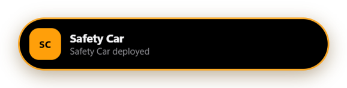
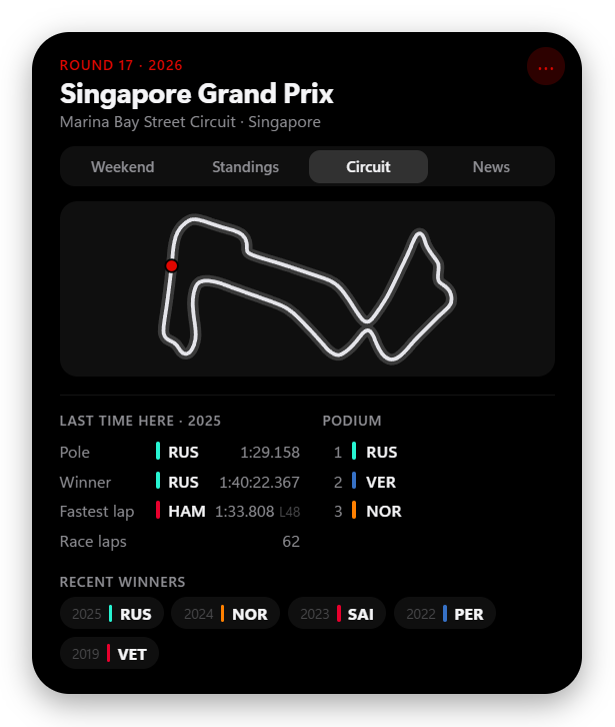
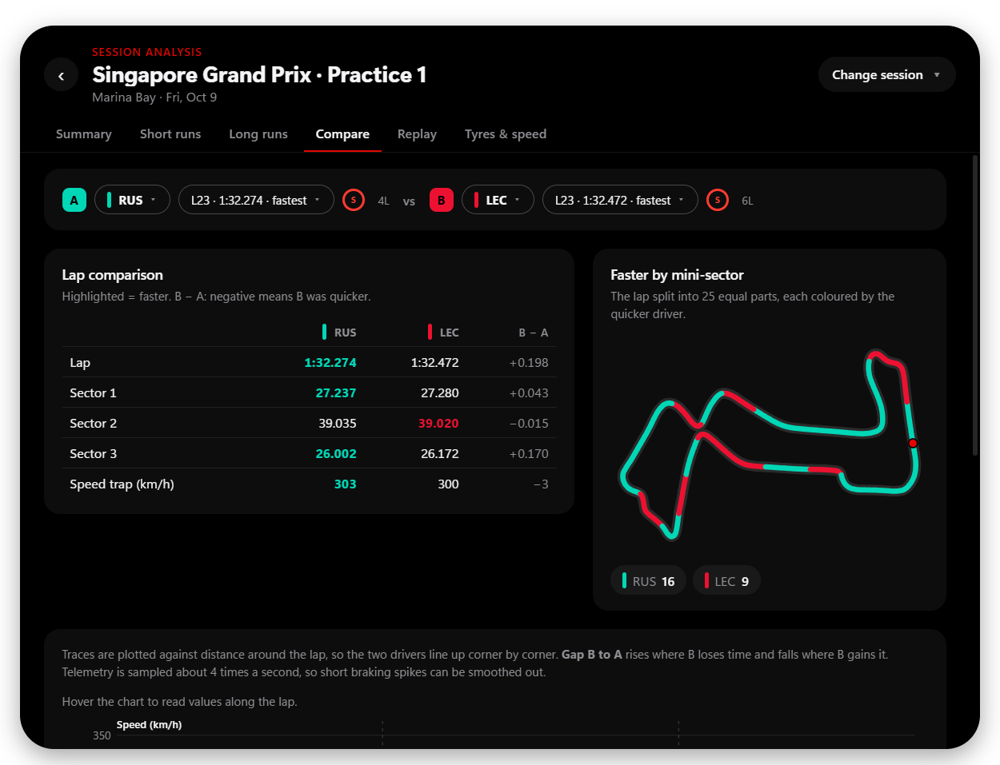
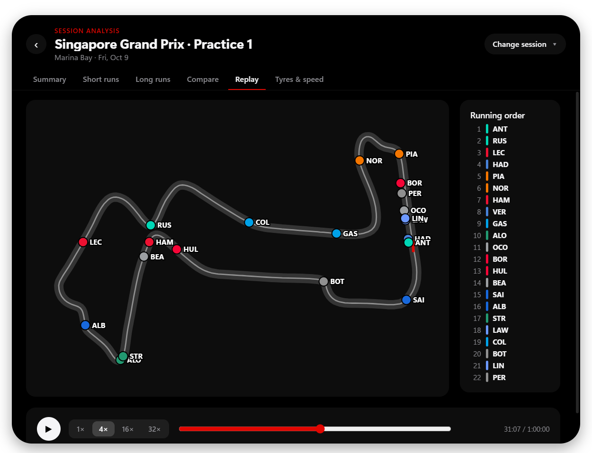

# F1 Island

**A Dynamic Island for Formula 1, on your Windows or macOS desktop.**

A small pill sits at the top of your screen with the countdown to the next session. Hover it and it expands with the weekend schedule, standings, title fight, circuit history and news. During a session it pops out with flag alerts (Safety Car, red flag, VSC, penalties…) and a live timing tower. After a session it expands a second time into a full analysis panel: short and long runs, driver comparison with telemetry, and a replay of every car on the track map.

> **Unofficial fan project.** Not affiliated with, endorsed by or connected to Formula 1, the FIA or any team. See [Disclaimer](#disclaimer).

<p align="center">
  <br>
  
</p>

F1 Island is written in **Rust** with [Tauri](https://tauri.app): the installer is about 5 MB and the app about 18 MB.

---

## What to expect

- **Windows 10/11 and macOS 12+.** Linux isn't supported.
- **Early version.** Expect rough edges. If something breaks, please [open an issue](../../issues) and say what happened.
- **Free data, no accounts or API keys.** Everything comes from free public sources (see [Where the data comes from](#where-the-data-comes-from)). Those sources are run by other people and can change or go down; when they do, parts of the island show "unavailable" instead of data.
- **Live features depend on F1's public live-timing feed.** If something doesn't show during a real session, please open an issue saying what happened on track.
- **Analysis numbers are estimates.** Long-run pace can't account for fuel loads or engine modes (nobody outside the teams knows them), and car telemetry is sampled about 4 times a second, so traces are smoother than broadcast graphics.

## Features

### The island

<p align="center">
  
  
  
</p>

**Hover the pill** and it expands into pages:

- **Live** (during a session): the running order, gaps, sector times, tyres, pit stops and the race control feed.
- **Weekend:** countdown, every session in your local time, and the top three of each finished session.
- **Standings:** drivers' top 10 with the gap to the leader, and the constructors.
- **Title:** who can still win each championship, their chances, and the earliest race the leader can clinch it (see below).
- **Circuit:** track map, last year's pole, winner and fastest lap, recent winners.
- **News:** latest headlines from Motorsport.com, The Race, Autosport and BBC Sport; click one to read its summary.

It also:

- **Stays out of your way:** always on top, but it never takes keyboard focus and everything around the pill is click-through.
- **Drags anywhere,** onto any monitor, and remembers where you left it.
- **Docks to the top edge** (Windows): drop it anywhere along the top of the screen and it slides to the centre, flush with the edge. Drag it away to detach it.
- **Auto-hides:** shrinks to a faint line and opens when you rest the mouse on it.
- **Opens from the keyboard:** `Ctrl+Alt+F` on Windows, `Cmd+Option+F` on Mac.
- **Gives a heads-up:** it peeks open 5 minutes before each session and when a session starts.

### Title fight

<p align="center"></p>

- **Who can still win:** exact maths from the points still available (25 per race, 8 per Sprint; 43 / 15 for constructors). Drivers who can no longer catch the leader are listed as out.
- **Clinch scenario:** the earliest race the leader can wrap it up, and the lead they'd need after it.
- **Chances:** an estimate, not a prediction. The rest of the season is simulated 20,000 times from each driver's recent form (newer results count more, retirements affect reliability only), with uncertainty in each driver's pace. It doesn't know about upgrades, penalties, weather or team orders.

### Live flags, alerts and timing

During a session the island pops out with a coloured alert:

| Event | Alert |
|---|---|
| Session starts / track clear | Green |
| Red flag | Red, pulsing |
| Safety Car, VSC, VSC ending | Amber, pulsing |
| Double yellow | Yellow, with the sector |
| Chequered flag | Chequered |
| Penalties, investigations, steward decisions, rain | Blue, with the message |

**Live timing tower:** from 15 minutes before a session until 15 minutes after it finishes, the island opens on the **Live** tab. It shows the whole field in one table: interval and gap, last lap, the three sector times (purple fastest overall, green personal best, yellow slower), best lap, tyre and its age, and PIT / EXIT / DNF / KO badges, with the race control feed beside it.

Beside each driver it also shows:

- **Stewards' decisions:** a time penalty (`+5s`), drive-through (`DT`), stop-go (`S/G`), an investigation still open (`INV`), a black and white flag (`B/W`), a reprimand or a disqualification. A penalty disappears once it's served, and an investigation once the stewards decide.
- **Pit stops** (races): how many, and how long the latest one took in the pit lane.

While a flag is out, the pill shows it (**SC / VSC / RED / YEL**) with a coloured ring, plus the lap and the leader. **Preview alerts** in the menu plays every alert, so you can see them any time.

### Session analysis

Click **"… analysis ›"** and the island grows into a large panel for any completed session of the season. Drag it by its header; **‹** goes back.

<p align="center"></p>

- **Summary:** classification (with Q1/Q2/Q3 in qualifying), weather, key race control messages, deleted lap times.
- **Short runs:** each driver's best lap with tyre and age, sector times, ideal lap, team ranking. In qualifying the best lap is across all segments and tagged with the segment it was set in.
- **Long runs / Race pace:** detected race-simulation runs with team ranking, lap-by-lap chart and tyre degradation trend. You choose the minimum run length and which drivers to compare.
- **Compare:** any two drivers, any lap each: lap and sector times, a track map coloured by who was faster in each mini-sector, and telemetry traces (speed, time gap, throttle, brake, gear) with a hover crosshair.
- **Replay:** the whole session played back on the track map with every car, the running order and race control messages, at 1× to 32× speed with a timeline to scrub.
- **Tyres & speed:** laps per compound per team, speed-trap top speeds.

<p align="center">
  <br>
  
</p>

## Install

Get the latest build from [**Releases**](../../releases/latest):

- **Windows 10/11:** `F1.Island_…_x64-setup.exe` (installer) or `F1-Island-…-win-portable.exe` (no install).
- **macOS 12+:** `F1.Island_…_aarch64.dmg` (Apple Silicon) or `F1.Island_…_x64.dmg` (Intel).

The builds aren't code-signed yet, so Windows SmartScreen ("Windows protected your PC": choose **More info → Run anyway**) or macOS Gatekeeper (use **System Settings → Privacy & Security → Open Anyway**; don't disable Gatekeeper globally) will ask you to confirm the first time.

### Updates

- **Windows installer:** checks for a newer release shortly after it starts and every few hours, downloads it in the background, and shows **Restart to update** beside the menu button. **Check for updates** in the menu forces a check. Updates are signed; the app refuses anything that isn't.
- **Windows portable app and the Mac app:** can't replace themselves, so they show **vX.Y.Z available**, which opens the download page.

### Windows

The island appears at the top-centre of your main screen, and a red dot appears in the system tray (it may be hidden behind the **^** arrow next to the clock). To have it start with Windows, tick **Start with Windows** in the tray menu. The installer installs for the current user (no admin needed) and can be removed from **Settings → Apps**.

### macOS

The app lives in the menu bar: a **checkered flag** opens its controls. There is no Dock icon or Cmd-Tab entry, and it follows you across Spaces and full-screen apps without taking keyboard focus.

On a notched MacBook, the island **attaches to the camera notch**. Hover the notch to open the panel beneath it; drag the panel away to detach it and drop it near the camera to attach it again. **Idle appearance** chooses between *Notch only* (tucked inside the notch until hovered) and *Stretched* (a slim black bar with a countdown or live race ticker). The camera area is always left empty. Other Macs and external monitors get the floating island.

The menu's **Preview stretched bar** offers dummy scenarios (next session, race, Safety Car, red flag, penalty), clearly marked **DEMO**.

> The notch support is new and hasn't had much testing on real hardware yet. Please report anything odd.

**Start at Login** is available once the app is in `/Applications`. The app doesn't request Screen Recording or Accessibility access.

## Using it

| To… | Do this |
|---|---|
| See more | Hover the pill |
| Keep it open | Click the island, or tick **Keep open** in its menu |
| Open the settings menu | Right-click the island, click **⋯**, or open the menu-bar / tray icon |
| Move it | Drag the pill (or the big panel by its header) |
| Put it back at the top-centre | Menu → **Reset position** |
| Show / hide from the keyboard | Windows `Ctrl+Alt+F`; Mac `Cmd+Option+F` |
| Hide it until you need it | Menu → **Auto-hide until hovered** (Mac notch: **Idle appearance**) |
| See every alert type | Menu → **Preview alerts** |
| Quit | Tray / menu-bar icon → **Quit** |

Settings are saved in `%APPDATA%\io.github.aymanbahhou.f1-island-rs\settings.json` on Windows and `~/Library/Application Support/io.github.aymanbahhou.f1-island-rs/settings.json` on Mac. A short log of live-timing status changes (`live-status.log`) sits next to it. The hotkey can be changed in the settings file (`"hotkey": "CommandOrControl+Alt+F"`); restart the app afterwards.

## Where the data comes from

All free and public; no account or key needed.

| What | Source |
|---|---|
| Schedule, results, standings, circuit history | [Jolpica F1 API](https://github.com/jolpica/jolpica-f1) (successor of the Ergast API) |
| Session analysis, telemetry, car positions, replay, fresher standings | [OpenF1](https://openf1.org) free historical data (available about 30 minutes after a session ends) |
| Live flags, race control, lap count, running order, pit-lane times | F1's public live-timing feed (the topics that don't need an F1TV account). Connected only from 15 minutes before a session until an hour after it |
| News | RSS feeds from Motorsport.com, The Race, Autosport and BBC Sport. Articles open on the publisher's site |

The app caches responses and spaces out requests to respect these services' rate limits. Thank you to the people who run them.

## Known limitations

- The builds aren't code-signed or notarized yet.
- Live alerts and the timing tower depend on F1's live-timing feed staying publicly accessible.
- While any session is live, OpenF1 blocks free access (even to past sessions) until it ends. During a session the analysis view only shows sessions you've opened before (they're cached on disk); everything else returns afterwards.
- The pit-lane time depends on a live-timing field that is only filled during a session; if it's missing, only the stop count shows.
- Long-run pace is an estimate (unknown fuel loads and engine modes).
- Telemetry and positions are about 4 samples per second.
- Replay goes up to 32×; faster than that, position data can't download quickly enough.

## Build it yourself

You need [Rust](https://rustup.rs), [Node.js](https://nodejs.org) 20 or newer, and on Windows the Visual Studio C++ build tools (WebView2 is built into Windows 11).

```bash
git clone https://github.com/AymanBAHHOU/f1-island-rs.git
cd f1-island-rs
npm install
npm run dev        # run it
npm run build      # build the installer (needs the signing key, see below)
```

Handy flags after `--` (for example `npm run dev -- --demo=race`): `--pinned` (start open), `--big` (open the analysis view), `--page=` and `--tab=` (pick a page), `--demo=next|race|safety-car|red-flag|penalty`, `--demo-alerts`, `--fake-update=9.9.9`, `--docked`.

Checks (the same ones CI runs):

```bash
cd src-tauri
cargo fmt --check
cargo clippy --all-targets -- -D warnings
cargo test --lib                   # add -- --ignored to also run the tests that use the network
```

### How it's put together

The **screen** is a web page (`ui/`) shown by the system's web view. The **logic** is Rust (`src-tauri/`): the page calls Rust functions by name and Rust sends events back. Everything that needs no window lives in the library and is tested without a screen.

```
ui/                       The island itself: pages, alerts, analysis view, track maps
ui/tauri-shim.js          Connects the page to the Rust commands and events
src-tauri/src/
  main.rs shell.rs menus.rs live.rs self_update.rs mac.rs
                          The program: window, tray and menus, live connection, updates
  geometry.rs dock.rs notch.rs platform.rs settings.rs
                          Where the island goes, per screen and per OS
  jolpica.rs openf1.rs news.rs snapshot.rs standings.rs circuit.rs schedule.rs results.rs season.rs
                          Data: schedule, results, standings, analysis data, headlines
  championship.rs title.rs
                          Title fight: clinch maths and the simulation
  live_client.rs live_state.rs merge.rs live_tab.rs live_window.rs clock.rs alerts.rs penalties.rs status_log.rs
                          Live timing: the feed, its state, alerts, stewards' decisions
  analysis.rs analysis_data.rs
                          Session analysis, telemetry, track map, replay
  updater.rs demo.rs      Update state, preview scenarios
```

### Releases

Push a version tag to build the Windows installer, the portable exe and the Mac apps, and create a **draft** GitHub release:

1. Set the same version in `src-tauri/tauri.conf.json`, `src-tauri/Cargo.toml` and `package.json`.
2. `git tag v0.1.2 && git push origin v0.1.2`
3. When the draft looks right, publish it on GitHub.

Updates are signed with a key pair: the public key is in `tauri.conf.json`, and the private key is the repository secret `TAURI_SIGNING_PRIVATE_KEY`. Keep a copy of the private key somewhere safe: without it, installed apps can never be updated to a new release. To make a new pair: `npx tauri signer generate -w f1-island.key`, then put the public key in `tauri.conf.json`. Never commit keys or passwords.

The app icon is an original checkered flag, not official F1 artwork.

## Disclaimer

F1 Island is an unofficial fan project. It is not associated in any way with the Formula 1 companies, the FIA or any Formula 1 team. F1, FORMULA ONE, FORMULA 1, FIA FORMULA ONE WORLD CHAMPIONSHIP, GRAND PRIX and related marks are trademarks of Formula One Licensing B.V. Team and driver names are used only to identify them.

## License

[MIT](LICENSE)
